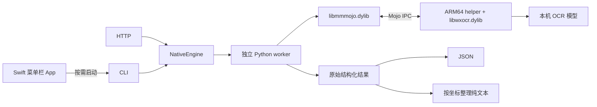

# 架构与接口

screen-ocr 在 macOS ARM64 上加载经过验证的第三方 OCR 运行时。Swift / AppKit 菜单栏 App 负责全局快捷键、截图和剪贴板；Python 标准库负责进程管理、Mojo 接口绑定、protobuf 编解码、文本整理和本机 HTTP 服务；一个 C 入口程序加载原生 OCR 动态库并调用其入口。

## 请求流程



`NativeEngine` 每次创建独立进程组。原生组件的全局状态和回调不会被不同请求共享；请求结束、超时或调用方关闭引擎时，父进程负责终止并回收工作进程组。默认 90 秒的外部期限覆盖启动、握手、识别和退出。

当前没有常驻模型池。菜单栏 App 空闲时仅保留原生界面，Python 与模型只在识别时启动。`serve` 常驻的是 HTTP 层，每次请求仍启动独立引擎。CLI 与菜单栏 App 无需预先启动 HTTP 服务。

菜单栏 App 使用 `RegisterEventHotKey` 独占注册 ⌥S，调用系统 `screencapture` 进行交互式截图，再以参数数组启动项目中的 `.venv/bin/python -m screen_ocr.cli`。它不依赖 shell PATH、Hammerspoon 或键盘监听。截图权限通过 CoreGraphics 的预检与请求接口交给系统管理。

## 文件职责

| 文件 | 职责 |
| --- | --- |
| `apps/macos/Sources/ScreenOCRApp/` | 原生菜单栏界面、快捷键、屏幕授权、状态提示与剪贴板 |
| `apps/macos/Sources/ScreenOCRCore/` | 项目目录检查、截图与 OCR 子进程、取消及临时文件清理 |
| `scripts/build_macos_app.py` | 构建、打包、本机签名和安装菜单栏 App |
| `scripts/prepare_runtime.py` | 校验固定安装包和库，提取文件，编译入口程序，生成运行时清单 |
| `native/ocr_helper.c` | 加载指定的 OCR 动态库，调用已确认的原生入口 |
| `src/screen_ocr/engine.py` | 进程隔离、整体超时、取消、回收及耗时测量 |
| `src/screen_ocr/worker.py` | 绑定已验证的 Mojo C ABI，管理回调与一次识别的生命周期 |
| `src/screen_ocr/protocol.py` | 编解码已确认的 protobuf 字段，校验类型和边界 |
| `src/screen_ocr/layout.py` | 根据已知矩形字段排序和拼接片段 |
| `src/screen_ocr/server.py` | 有容量限制的本机 HTTP 接口 |
| `src/screen_ocr/cli.py` | 命令行参数、结果输出和服务生命周期 |
| `integrations/hammerspoon/screen_ocr.lua` | 可选的旧自动化集成，不是菜单栏 App 的依赖 |

## 固定运行时

当前支持的源应用版本为 **4.2.0，build 270352，ARM64**，具体来源见[第三方来源说明](THIRD_PARTY_NOTICES.md)。准备脚本从上游官方 DMG 或用户提供的匹配应用中提取：

- `Frameworks/libmmmojo.dylib`：进程间通信接口。
- `Resources/libwxocr.dylib`：实际 OCR 引擎。
- `Resources/` 下固定清单中的模型和字符表。

`Frameworks/libwxocr.dylib` 不是本项目使用的 OCR 引擎文件。不能只凭文件名替换动态库，也不能把其他版本模型与当前引擎混用。

下载地址、DMG 与全部提取文件的 SHA-256 固定在 `src/screen_ocr/data/runtime-baseline.json` 中。准备脚本读取该基线，验证安装包、应用版本和全部文件，并为输出文件生成 `runtime.json` 清单。该清单记录来源与哈希，不代表运行时目录受到防篡改保护；请使用自己准备的本地运行时。

本仓库不分发第三方二进制或模型。这里的“native”指加载 macOS ARM64 原生引擎，不表示 OCR 模型由本项目训练或以开源许可证提供。

## Mojo 与 protobuf 契约

以下消息已通过实际运行时通信确认：

| 请求编号 | 用途 |
| --- | --- |
| `10001` | OCR 能力握手 |
| `10010` | 携带任务编号和本地图片路径的识别请求 |
| `10011` | 识别响应 |

字段编号的研究参考及固定提交见[第三方来源说明](THIRD_PARTY_NOTICES.md#协议研究参考)。本项目使用自行实现的编解码器，不依赖生成的 protobuf 模块。

仅处理已确认的字段。未知 protobuf 字段按 wire type 跳过；不会从数值、候选名称或相似字段推测其含义。已知字段的错误 wire type、截断数据、无效 UTF-8 和数值溢出会被拒绝。

## Python 接口

在项目目录中运行：

```sh
uv run python - <<'PY'
from pathlib import Path
from screen_ocr.engine import NativeEngine
from screen_ocr.layout import reconstruct_text

engine = NativeEngine(Path(".runtime"), timeout=90)
try:
    outcome = engine.recognize_detailed(Path("tests/fixtures/english.png"))
    result = outcome.result
    if result["errcode"] != 0:
        raise RuntimeError(f"OCR failed: {result['errcode']}")
    print(reconstruct_text(result)["text"])
    print(outcome.timings)
finally:
    engine.close()
PY
```

`recognize(image)` 返回结果字典；`recognize_detailed(image)` 另外返回单调时钟测量的耗时。两者使用同一识别路径。

| 结果字段 | 含义 |
| --- | --- |
| `imgpath` | 本次请求传给引擎的本地图片路径 |
| `errcode` | 引擎错误码；`0` 表示成功 |
| `width` / `height` | 图片尺寸 |
| `ocr_response` | 引擎返回的片段列表，保留原始顺序 |
| 片段 `text` | 引擎识别出的字符串 |
| 片段 `left` / `top` / `right` / `bottom` | 图片坐标系中的矩形边界 |
| 片段 `rate` | 引擎返回的置信度，不等同于经过校准的准确率 |

## 纯文本阅读顺序

原生引擎可能把一行拆为多个片段，也可能按与视觉顺序不同的顺序返回。直接对 `ocr_response` 做字符串拼接不能保证可读顺序。

`reconstruct_text(result)` 使用 `geometry_rows_v1`：

1. 根据垂直重叠和中心距离，将能互相对齐的矩形归为同一视觉行。
2. 从上到下排列视觉行，每行从左到右排列片段。
3. 拼接水平相邻的片段，通过矩形间隙估计是否插入一个空格。
4. 对宽间隔或明显重叠的片段保留换行，并附带警告。

算法不会修改原始结果、补字、改写大小写或进行拼写纠正。它面向横排截图，不提供完整文档排版分析：多栏内容使用逐行顺序，表格结构、旋转文字、跨行断词和原始空格不保证恢复。

返回对象包含 `text`、`lines`、`algorithm`、`source_fragment_count`、`output_line_count` 和 `warnings`。每行的 `source_indices` 是原始片段的 **0 起始索引**，`separators` 记录片段之间加入的分隔符，便于排查文字如何拼接。

CLI 的 `--text`、菜单栏 App 和可选自动化集成的剪贴板使用这一层；默认 JSON 和 HTTP 结果保持原始数据。

菜单栏 App 使用 `--text-file` 将文本写到权限为 `0600` 的新临时文件，完成后读取并删除，避免长文本堵住任务输出管道。每次任务使用独立的 `0700` 临时目录；失败、取消和空结果不会触发复制。App 的取消与正常退出会等待 CLI 清理，再释放当前任务，不会在清理期间启动新的识别。

CLI 对 SIGINT 和 SIGTERM 执行清理；取消开始后忽略重复取消信号，确保原生工作进程组被回收。更多安装与操作说明见[菜单栏 App 文档](menu-bar-app.md)。

## 耗时与异常

`recognize_detailed()` 的 `timings` 单位均为毫秒：

- `wall_ms`：整个调用，包括临时文件、进程启动、原生工作、回收和读取结果。
- `worker_startup_ms`：工作进程初始化至 OCR 握手完成。
- `worker_recognition_ms`：请求构造、IPC、推理与响应解码。
- `worker_shutdown_ms`：原生停止与移除操作。
- `worker_total_ms`：以上三个工作进程阶段总计。

工作进程计时不包括 Python 启动、导入和输出文件序列化，因此不能用它替代用户可见的 `wall_ms`。本项目不解释引擎内部未确认含义的耗时字段。

超时抛出 `EngineTimeout`，原生启动或通信失败抛出 `NativeError`；它们都不会触发其他 OCR 引擎。布局数据不合法时，纯文本重建抛出 `LayoutError`，原始 JSON 仍可用于诊断。
